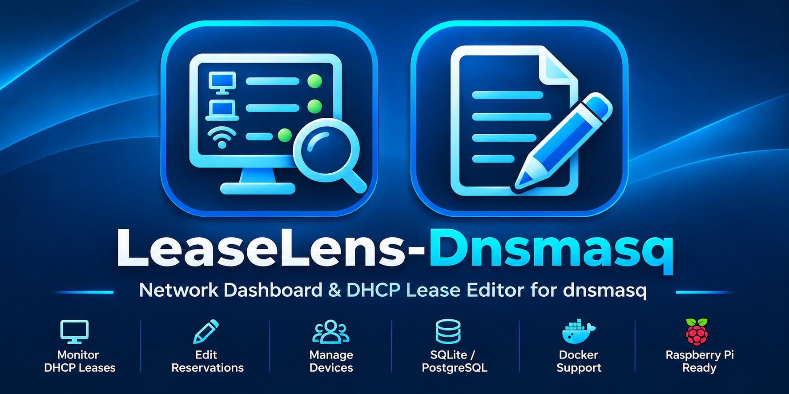
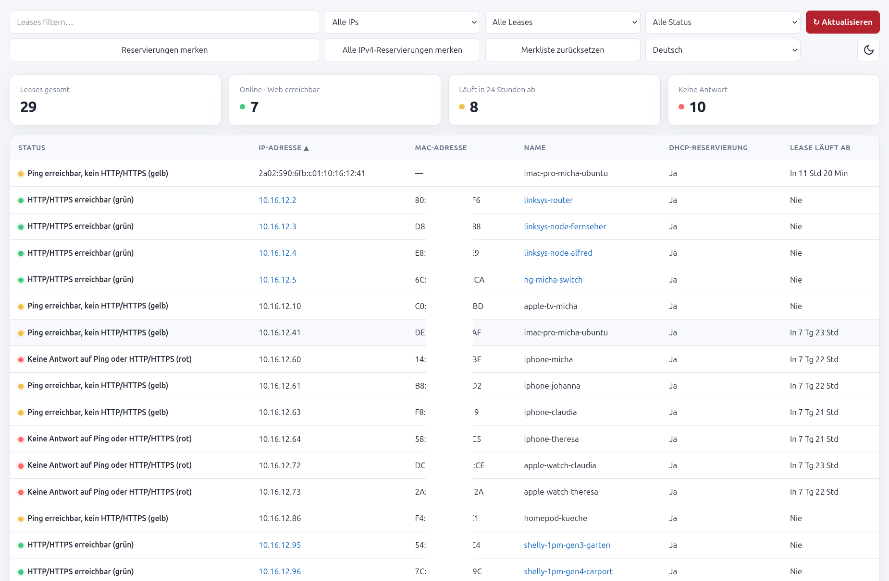
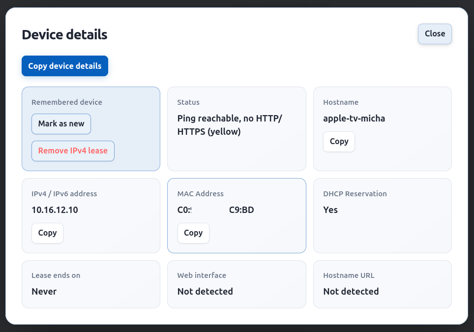
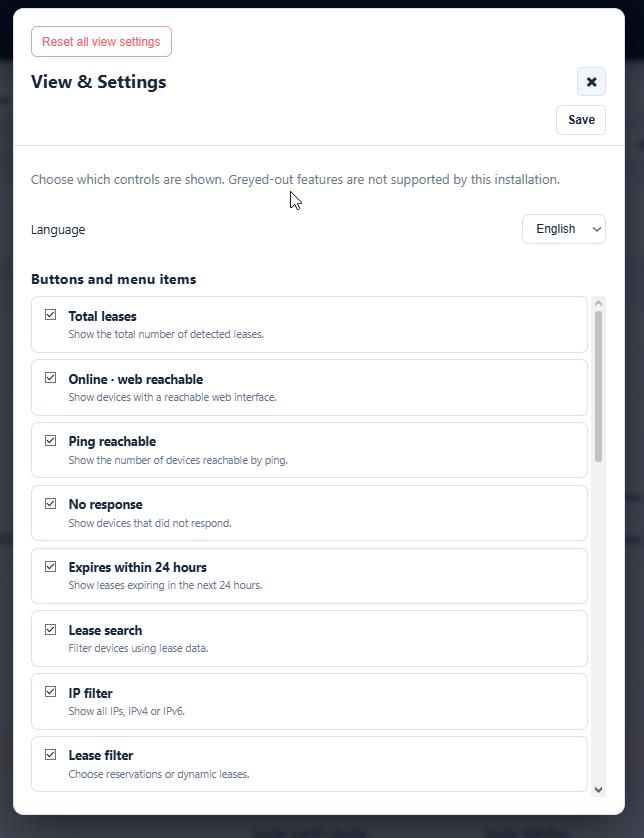

# LeaseLens-Dnsmasq

**LeaseLens — Dnsmasq Network Dashboard**

LeaseLens is a lightweight web dashboard for viewing and monitoring DHCP leases from [dnsmasq](https://thekelleys.org.uk/dnsmasq/doc.html). It is written in Go and provides a searchable, sortable view of network devices, manufacturer information, reservation status, lease expiry, and reachability.



[](https://hub.docker.com/r/1968michael1968/leaselens-dnsmasq)
[](https://go.dev/)
[](https://github.com/anonymous-writer/leaselens-dnsmasq/blob/main/LICENSE)

- [GitHub repository and full documentation](https://github.com/anonymous-writer/leaselens-dnsmasq)
- [Docker Hub — LeaseLens-Dnsmasq](https://hub.docker.com/r/1968michael1968/leaselens-dnsmasq)
- [GitHub Container Registry (GHCR)](https://github.com/anonymous-writer/leaselens-dnsmasq/pkgs/container/leaselens-dnsmasq)







## Features

- Searchable and sortable DHCP lease table for IPv4 and IPv6
- Filters for IP version, DHCP reservations, and device reachability
- HTTP/HTTPS checks and ping-based status indication
- Clickable IP addresses and hostnames when the hostname resolves to the lease IP
- Device details including hostname, IP, MAC, manufacturer, reservation status, lease expiry, and detected web URLs
- Local IEEE OUI database lookup for MAC manufacturers; locally administered/randomized MAC addresses are identified separately
- `NEW` indicator for MAC addresses not in the remembered-device list
- Per-device actions to mark a device as known or mark it as new again
- Bulk action to mark currently detected DHCP reservations as known
- Bulk action to mark all configured IPv4 reservations as known, including offline devices
- Bulk action to reset the remembered-device list (confirmation required)
- Persistent remembered-device data in `/data/known-macs.json`
- Infinite leases displayed as `Never`; expired leases displayed as `Expired`
- Manual refresh; lease countdowns update locally between refreshes
- Dark/light theme and responsive desktop/mobile interface
- Dashboard preferences, including language, theme, filters, sorting, grouping, and visible controls where supported by the deployed version
- Database-backed persistence for supported dashboard preferences
- JSON API at `/leases` and POST actions at `/known-macs`
- Bounded concurrent checks for device web interfaces
- Multi-architecture image (`linux/amd64` and `linux/arm64`)
- Container runs as `root`

**Native-only features are not included in the Docker image.** Native Linux builds can detect the installed dnsmasq version and can optionally provide an IPv4 lease-release action and native DHCP-hook integrations. These features depend on the host's dnsmasq installation and are not enabled by this container image. See the [main repository README](https://github.com/anonymous-writer/leaselens-dnsmasq) for native installation and setup.

## Quick start

Create a directory for persistent application data:

```bash
mkdir -p data
```

Start the latest stable Docker Hub image:

```bash
docker run -d \
  --name leaselens-dnsmasq \
  --restart unless-stopped \
  --network host \
  -e PORT=3008 \
  -e LOG_LEVEL=INFO \
  -v /var/lib/dnsmasq:/var/lib/dnsmasq:ro \
  -v "$(pwd)/data:/data" \
  1968michael1968/leaselens-dnsmasq:latest
```

Open **http://YOUR_HOST:3008** in your browser, replacing `YOUR_HOST` with the IP address or hostname of the machine running the container.

Host networking lets LeaseLens reach devices on your LAN, including IPv6 devices, when the host has the necessary routes. With `--network host`, do not use `-p` or `--publish`; the application listens directly on the host network.

The container runs as `root`. This is intentional for this image's current deployment model and is not changed by the Docker instructions in this README.

The application and its API do not provide built-in user authentication. Keep the service on a trusted network or protect it with a properly configured reverse proxy. Do not expose it directly to the public internet.

## Required dnsmasq files

By default, LeaseLens reads:

- `/var/lib/dnsmasq/dnsmasq.leases` — DHCP lease file
- `/var/lib/dnsmasq/dnsmasq.dhcphosts` — optional DHCP reservation file

Example dnsmasq configuration:

```ini
dhcp-leasefile=/var/lib/dnsmasq/dnsmasq.leases
dhcp-hostsfile=/var/lib/dnsmasq/dnsmasq.dhcphosts
```

Mount the containing directory read-only into the container. Mounting the directory rather than individual files helps ensure the application sees the current lease file if dnsmasq replaces it. The hosts file is optional; reservations defined only in that file cannot be identified when it is absent or unreadable.

## Docker Compose

Example `compose.yaml`:

```yaml
services:
  leaselens-dnsmasq:
    image: 1968michael1968/leaselens-dnsmasq:latest
    container_name: leaselens-dnsmasq
    restart: unless-stopped
    environment:
      PORT: "3008"
      LOG_LEVEL: "INFO"
      HOME: /tmp
      XDG_RUNTIME_DIR: /tmp
    network_mode: host
    volumes:
      - /var/lib/dnsmasq:/var/lib/dnsmasq:ro
      - ./data:/data
```

Create the data directory before the first start:

```bash
mkdir -p data
docker compose up -d
```

For Podman on SELinux-enabled systems, use `./data:/data:Z` if relabeling is required. With Docker, use `./data:/data` unless SELinux relabeling is required by the host.

## Using the dashboard

- Search by hostname, IP address, MAC address, lease time, status, or reservation state.
- Use the IP-version filter to show all leases, IPv4 only, or IPv6 only.
- Use the reservation filter to show all leases, reservations only, or dynamic leases only.
- Select a column heading to change the sort order.
- Select a row to open device details. Copy individual hostname, IP, or MAC values, or copy all device details from the dialog.
- Click **Refresh** to reload leases and repeat reachability checks. Countdown values update locally between refreshes; network checks do not run every second.
- Status colors indicate HTTP/HTTPS response, ping response without a detected web interface, or no response to either check. Hover over a status indicator for an explanation.
- The page shows the last successful refresh time and a separate loading/error status. If a refresh fails, the previously loaded lease list remains visible.
- `NEW` means the device's MAC address is not in the remembered list. Use **Mark as known** to remember it or **Mark as new** to remove it from that list.
- **Mark reservations known** remembers currently detected reservations with valid MAC addresses.
- **Mark all IPv4 reservations** reads the configured hosts file and can remember configured IPv4 reservations even when the devices are offline. Entries need both a valid MAC and an IPv4 address; IPv6-only entries are skipped.
- **Reset remembered** clears the remembered MAC list after confirmation. This does not delete the lease or DHCP hosts files.

Remembered devices persist across container restarts only when `/data` is mounted to a persistent host directory. IPv6 leases without a valid MAC address remain visible but cannot be reliably identified in the MAC-based remembered-device list.

### UI preferences

The **View & Settings** dialog stores supported dashboard preferences centrally in the configured database in versions with database-backed UI settings. This is intended to keep preferences such as language, theme, visible controls, filters, sorting, and group selection consistent across browsers and devices. Persistence of each preference depends on the deployed application version; verify the behavior after upgrading.

Use **Reset all view settings** to restore default dashboard preferences. The reset is intended to affect presentation settings only. It must not delete DHCP leases, reservations, remembered devices, DHCP event history, or ntfy configuration.

Older builds may store some UI preferences in `/data/ui-settings.json`. For those builds, keep `/data` mounted persistently and set `UI_SETTINGS_FILE` if you use a non-default path. UI preferences are separate from `KNOWN_MACS_FILE`, which stores remembered-device state.

## API

| Method | Path | Description |
|---|---|---|
| `GET` | `/` | Web dashboard |
| `GET` | `/leases` | JSON response containing the leases array |
| `POST` | `/known-macs` | Mark/unmark MAC addresses or perform supported bulk actions |

Example:

```bash
curl http://localhost:3008/leases
```

Each object in the `leases` array can include `staticIP`, `leasetime`, `leaseExpiry`, `macAddress`, `ipAddress`, `name`, `webUrl`, `webHostUrl`, `status`, and `isNew`. `leaseExpiry` is the lease-expiry Unix timestamp in seconds; `0` indicates an infinite lease.

`POST /known-macs` accepts JSON. The documented actions are:

| Action | Example payload | Result |
|---|---|---|
| `mark` (default) | `{"mac":"AA:BB:CC:DD:EE:FF","action":"mark"}` | Remember one valid MAC address |
| `unmark` | `{"mac":"AA:BB:CC:DD:EE:FF","action":"unmark"}` | Remove one MAC address from the remembered list |
| `reset` | `{"action":"reset"}` | Clear the remembered list |
| `mark-reservations` | `{"action":"mark-reservations"}` | Remember currently detected DHCP reservations with valid MAC addresses |

The `mark-reservations` response includes a `count` field. The web interface's **Mark all IPv4 reservations** button reads the configured hosts file directly; do not assume that this button corresponds to an API action. The API has no authentication.

## Configuration

| Environment variable | Default | Description |
|---|---|---|
| `CONFIG_FILE` | empty | Optional path to the YAML-style configuration file |
| `HOST` | `0.0.0.0` | Web server listen address |
| `PORT` | `5000` | Web server port |
| `DNSMASQ_LEASES_FILE` | `/var/lib/dnsmasq/dnsmasq.leases` | DHCP lease file path |
| `DNSMASQ_HOSTS_FILE` | `/var/lib/dnsmasq/dnsmasq.dhcphosts` | Optional DHCP hosts file path |
| `KNOWN_MACS_FILE` | `/data/known-macs.json` | Persistent remembered-MAC list |
| `UI_SETTINGS_FILE` | Application default | Optional path for legacy file-backed UI preferences |
| `OUI_DATABASE_FILE` | Auto-detected | Optional path to a local IEEE OUI database; the image includes a database |
| `LOG_LEVEL` | `INFO` | Minimum verbosity: `DEBUG`, `INFO`, `WARN`, or `ERROR` |
| `WEB_UI_TIMEOUT` | `500ms` | Timeout for HTTP/HTTPS and hostname checks |
| `PING_TIMEOUT` | `1200ms` | Timeout for ping checks |
| `WEB_UI_MAX_WORKERS` | `16` | Maximum concurrent web-interface checks |
| `APP_VERSION` | Build default | Version shown by the application |
| `APP_RELEASE_DATE` | Build default | Build/release date shown by the application |
| `REPO_URL` | `https://github.com/anonymous-writer/leaselens-dnsmasq` | Repository URL shown in the UI |
| `SYSTEM_NAME` | `LeaseLens` | Optional custom label displayed in the header |

The Docker image includes a local IEEE OUI database for manufacturer identification. No external lookup service is required. If manufacturer data cannot be loaded, leases still appear but the manufacturer may show as unknown.

Configuration-file keys and precedence are documented in the [main README](https://github.com/anonymous-writer/leaselens-dnsmasq#configuration). Docker deployments can use environment variables for runtime configuration. Do not assume native-only options are available in the container.

## Database backends

LeaseLens uses SQLite by default and also supports optional PostgreSQL. See the [PostgreSQL setup guide](https://github.com/anonymous-writer/leaselens-dnsmasq/blob/main/docs/postgresql.md) for configuration details.

PostgreSQL starts with a fresh schema; it does not import SQLite data or legacy files. Back up your database before changing database configuration or upgrading.

## Logging

Set `LOG_LEVEL` to control the minimum verbosity:

| Level | Messages shown | Typical use |
|---|---|---|
| `DEBUG` | Debug, info, warnings, and errors | Temporary troubleshooting |
| `INFO` | Info, warnings, and errors | Normal operation (default) |
| `WARN` | Warnings and errors | Quieter operation |
| `ERROR` | Errors only | Important failures only |

If `LOG_LEVEL` is unset or contains an unknown value, the application uses `INFO`.

Example:

```yaml
environment:
  PORT: "3008"
  LOG_LEVEL: "DEBUG"
```

View container logs:

```bash
docker logs -f leaselens-dnsmasq
```

Routine refreshes and individual device details are intentionally not logged by default to avoid noisy logs and unnecessary exposure of network information.

## Image tags and releases

**Docker Hub — stable releases**

```bash
docker pull 1968michael1968/leaselens-dnsmasq:latest
```

**GitHub Container Registry — beta and development**

```bash
docker pull ghcr.io/anonymous-writer/leaselens-dnsmasq:go-beta
```

The `go-beta` tag tracks the latest published pre-release. Stable GHCR releases use version tags and `latest`; pre-releases do not update the GHCR `latest` tag.

Publishing a GitHub Release publishes a GHCR image through the repository's Docker workflow. It does not publish a Docker Hub image unless a separate Docker Hub publishing workflow is configured. Use a version-specific tag when you need a fixed version, and check the [Docker Hub tags page](https://hub.docker.com/r/1968michael1968/leaselens-dnsmasq/tags) to confirm which versions have actually been published there.

## Security

LeaseLens does not provide built-in authentication for its web interface or API. Keep it on a trusted network and do not expose it directly to the public internet. Host networking improves LAN reachability but does not add access control.

If you put LeaseLens behind a reverse proxy, configure the proxy and application security settings according to the [HTTPS-secure mode documentation in the main README](https://github.com/anonymous-writer/leaselens-dnsmasq#https-secure-mode-behind-a-reverse-proxy). In proxy-secure mode, bind LeaseLens to loopback (`HOST=127.0.0.1`) unless the application port is otherwise firewalled. Keep your authentication layer (for example, Authelia) configured on the reverse proxy; the proxy-token mechanism is not a replacement for authentication.

## Source code and license

- Source code: https://github.com/anonymous-writer/leaselens-dnsmasq
- License: MIT — see [LICENSE](https://github.com/anonymous-writer/leaselens-dnsmasq/blob/main/LICENSE).

For native installation, standalone binaries, DHCP event history, ntfy notifications, and the full project configuration reference, see the [main GitHub README](https://github.com/anonymous-writer/leaselens-dnsmasq).
